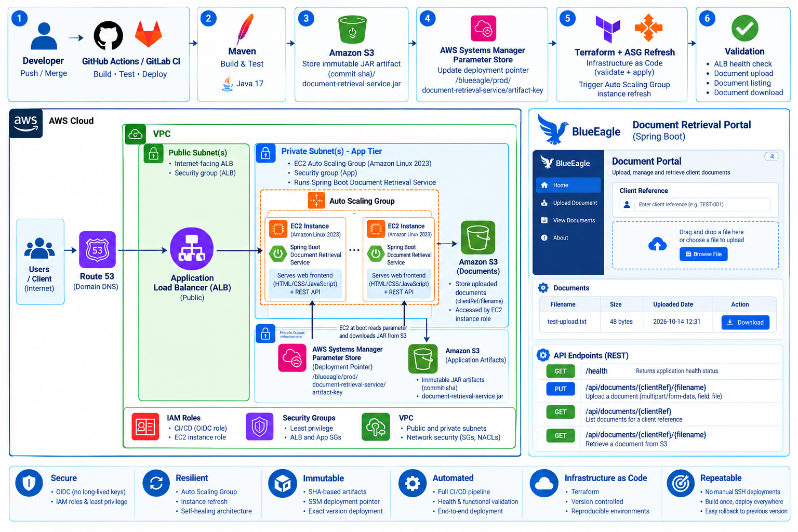

# BlueEagle Document Retrieval Service

A Spring Boot document management application deployed on AWS using **Terraform, GitLab CI/CD, GitHub Actions, AWS OIDC federation, Amazon S3, Systems Manager Parameter Store, EC2 Auto Scaling, and an Application Load Balancer**.

This project demonstrates a build-once, deploy-the-exact-same-artifact strategy, immutable application releases, infrastructure automation, and end-to-end validation.

> **Project status:** The application and browser-based frontend were tested through the ALB. The CI/CD pipeline now validates document upload, download, and content integrity. HTTPS, authentication, and client-level authorization remain future improvements.

## Table of Contents

- [Overview](#overview)
- [Architecture](#architecture)
- [Technology Stack](#technology-stack)
- [Application Features](#application-features)
- [API Reference](#api-reference)
- [CI/CD Pipeline](#cicd-pipeline)
- [Immutable Artifact Deployment](#immutable-artifact-deployment)
- [Security](#security)
- [Infrastructure](#infrastructure)
- [Validation Results](#validation-results)
- [Repository Structure](#repository-structure)
- [Local Development](#local-development)
- [Troubleshooting and Lessons Learned](#troubleshooting-and-lessons-learned)
- [Cleanup](#cleanup)
- [Future Improvements](#future-improvements)

---

## Overview

The Document Retrieval Service provides a browser-based portal for uploading, listing, and retrieving documents stored in Amazon S3.

The application runs on EC2 instances behind an Application Load Balancer. Terraform provisions the infrastructure, while CI/CD workflows build and publish application artifacts and validate deployments.

### Technology Stack

| Component | Technology |
|---|---|
| Application | Java 17, Spring Boot 3.3.4 |
| Build | Maven |
| Frontend | HTML, CSS, JavaScript |
| Document storage | Amazon S3 |
| Infrastructure as Code | Terraform |
| CI/CD | GitLab CI/CD and GitHub Actions |
| AWS authentication for CI | OIDC federation and AWS STS |
| Deployment pointer | AWS Systems Manager Parameter Store |
| Compute | EC2, Launch Template, Auto Scaling Group |
| Traffic management | Application Load Balancer |
| Process management | systemd |

## Architecture



The architecture covers two main workflows:

**Application request flow**

1. A user accesses the browser-based document portal.
2. The Application Load Balancer forwards requests to the Spring Boot application.
3. The application processes document operations using the client reference and filename.
4. Amazon S3 stores and retrieves the document objects.

**Application delivery flow**

1. CI/CD builds and tests the application.
2. The packaged JAR is published to S3 under a Git commit SHA.
3. The SSM deployment pointer identifies the artifact to deploy.
4. The EC2 bootstrap process downloads that artifact and configures systemd.
5. The Auto Scaling Group refreshes instances.
6. The pipeline validates ALB health and application functionality.

The actual deployed network configuration should be distinguished from planned enhancements. HTTPS and company-domain configuration are future improvements until they have been implemented and verified.

## Application Features

- Browser-based document portal served by Spring Boot.
- Multipart document uploads.
- Document listing by client reference.
- Document downloads from Amazon S3.
- Health endpoint for application and load balancer checks.
- AWS SDK credential resolution through `DefaultCredentialsProvider`.
- systemd-managed application lifecycle.
- Immutable JAR deployment without building the application on EC2.
- Automated document upload, download, and content verification in CI/CD.

The application uses Amazon S3 for document storage and does not require a relational database for the current functionality.

## API Reference

| Method | Endpoint | Purpose |
|---|---|---|
| `GET` | `/health` | Checks application health |
| `PUT` | `/api/documents/{clientRef}/{filename}` | Uploads a document |
| `GET` | `/api/documents/{clientRef}` | Lists documents for a client reference |
| `GET` | `/api/documents/{clientRef}/{filename}` | Retrieves a document |

### Health Check

```bash
curl -i http://localhost:8080/health
```

Expected response: HTTP `200 OK`.

### Upload a Document

The upload endpoint expects a multipart form field named `file`.

```bash
curl -i -X PUT \
  "http://localhost:8080/api/documents/TEST-001/test-upload.txt" \
  -F "file=@test-upload.txt"
```

The application uses this S3 object key pattern:

```text
{clientRef}/{filename}
```

A successful upload returns HTTP `201 Created`.

### List Documents

```bash
curl -i \
  "http://localhost:8080/api/documents/TEST-001"
```

A successful request returns HTTP `200 OK` and the documents associated with that client reference.

### Retrieve a Document

```bash
curl -f \
  "http://localhost:8080/api/documents/TEST-001/test-upload.txt" \
  -o downloaded-test.txt
```

Verify the downloaded content:

```bash
cat downloaded-test.txt
```

Use synthetic documents for testing. Do not upload real customer KYC documents to this demonstration application.

## CI/CD Pipeline

The project contains GitLab CI/CD and GitHub Actions workflows for automating application delivery.

The pipeline separates artifact creation from application rollout and validates the deployed service.

### Pipeline Flow

```text
Source Change
     |
     v
Tests and Build
     |
     v
Publish Immutable JAR to S3
     |
     v
Terraform Infrastructure
     |
     v
Update SSM Deployment Pointer
     |
     v
Auto Scaling Instance Refresh
     |
     v
ALB Health Validation
     |
     v
Document Endpoint Validation
     |
     v
Verify Downloaded Content
```

### End-to-End Document Validation

The `validate_document` job uses a dedicated CI test fixture with known content.

It:

1. Authenticates to AWS through GitLab OIDC federation.
2. Retrieves the ALB DNS name.
3. Creates a deterministic test document.
4. Uploads it using the document API.
5. Downloads it using the same client reference and filename.
6. Compares the returned content against the expected content.
7. Fails the job if the request fails or the content differs.

The CI fixture uses a separate client reference from the manually uploaded `MUST-001` test document.

A green pipeline confirms that the configured stages and checks passed for that pipeline run. It does not, by itself, establish that all production security requirements have been met.

## Immutable Artifact Deployment

Application artifacts are stored using the Git commit SHA.

### Artifact Location

```text
s3://blueeagle-prod-app-doc-artifacts/
└── document-retrieval-service/
    └── <git-sha>/
        └── document-retrieval-service.jar
```

### SSM Deployment Pointer

The deployment pointer is:

```text
/blueeagle/prod/document-retrieval-service/artifact-key
```

Its value identifies the JAR to deploy, for example:

```text
document-retrieval-service/<git-sha>/document-retrieval-service.jar
```

### EC2 Bootstrap

During instance initialization, the bootstrap process:

1. Installs the required Java runtime and AWS CLI.
2. Reads the artifact key from SSM Parameter Store.
3. Downloads the JAR from the artifact bucket.
4. Configures the systemd service.
5. Starts the application and checks its health.

This pattern supports repeatable releases, commit-specific artifact identification, and separation of build and deployment responsibilities.

## Security

### CI/CD Authentication

GitHub Actions and GitLab CI/CD use OIDC federation to obtain temporary AWS credentials through AWS STS rather than relying on long-lived AWS access keys.

CI roles should have least-privilege permissions restricted to the operations required by each workflow.

### EC2 IAM Role

The EC2 instance role should provide only the access required for:

- Reading the application artifact.
- Reading the deployment pointer.
- Uploading, listing, and retrieving permitted document objects.
- Accessing required Systems Manager capabilities.

Broad administrator permissions should not be used for routine application execution.

### Transport Security

The verified deployment used an HTTP ALB endpoint. HTTPS remains a planned enhancement requiring a company-controlled domain and a trusted TLS certificate, such as one issued through AWS Certificate Manager.

The intended configuration includes an HTTPS listener, certificate, HTTP-to-HTTPS redirect, and DNS record.

### Application Security Limitations

This project demonstrates application delivery and AWS platform engineering patterns. It is not production-ready for real KYC data without authentication, client-level authorization, and the other security controls required by the intended environment.

A client reference is an identifier, not proof of identity or authorization.

## Infrastructure

Terraform manages the AWS infrastructure required to run the application.

Components include:

- Amazon VPC and subnets.
- Application Load Balancer and target group.
- EC2 Launch Template.
- Auto Scaling Group.
- EC2 IAM role and instance profile.
- Security groups.
- S3 artifact bucket.
- S3 document bucket.
- Systems Manager Parameter Store deployment pointer.

The application listens on port `8080`. The ALB forwards traffic to the target group, which checks the health of registered instances.

### S3 Buckets

| Bucket | Purpose |
|---|---|
| `blueeagle-prod-app-doc-artifacts` | Immutable application JAR artifacts |
| `blueeagle-prod-app-documents` | Uploaded document objects |

Separating these buckets allows artifact delivery and document access to be governed independently.

## Validation Results

The following checks were successfully completed during testing.

| Test | Result |
|---|---|
| Application health endpoint | HTTP 200 |
| Frontend served through ALB | HTTP 200 |
| Document upload | HTTP 201 |
| Document listing | HTTP 200 |
| Document download | Passed |
| Downloaded content verification | Passed |
| EC2 Auto Scaling instance | Healthy |
| ALB target group | Healthy |
| GitLab CI/CD pipeline | All configured stages green |

The deployment troubleshooting process also identified and resolved an artifact-access failure during EC2 bootstrap. The artifact was published to S3, the SSM pointer was corrected, and a replacement instance successfully started the application.

## Repository Structure

The following illustrates the intended repository organization. Adjust it to match the files actually present in the repository.

```text
document-retrieval-service/
├── .github/
│   └── workflows/
├── .gitlab-ci.yml
├── architecture/
│   └── architecture.png
├── docs/
├── scripts/
├── src/
│   └── main/
│       └── resources/
│           └── static/
├── terraform/
│   ├── bootstrap/
│   └── infrastructure/
├── pom.xml
└── README.md
```

## Local Development

### Prerequisites

- Java 17 or a compatible JDK.
- Maven.
- AWS CLI.
- An AWS identity with the required permissions for the document bucket.

### Build

```bash
mvn clean package
```

### Run Locally

```bash
AWS_REGION=us-east-1 \
S3_BUCKET_NAME=blueeagle-prod-app-documents \
java -jar target/document-retrieval-service.jar
```

The AWS SDK `DefaultCredentialsProvider` resolves credentials from the local environment. On EC2, the instance role supplies AWS credentials without embedding access keys in the application.

### Test Locally

Create a harmless test file:

```bash
echo "Local document retrieval test" > test-upload.txt
```

Upload it:

```bash
curl -i -X PUT \
  "http://localhost:8080/api/documents/TEST-LOCAL-001/test-upload.txt" \
  -F "file=@test-upload.txt"
```

List and download it:

```bash
curl -i \
  "http://localhost:8080/api/documents/TEST-LOCAL-001"
```

```bash
curl -f \
  "http://localhost:8080/api/documents/TEST-LOCAL-001/test-upload.txt" \
  -o downloaded-test.txt
```

## Troubleshooting and Lessons Learned

### EC2 Bootstrap Failure

Inspect the bootstrap log and service status:

```bash
sudo tail -n 100 /var/log/docservice-user-data.log
sudo systemctl status docservice --no-pager -l
sudo journalctl -u docservice -n 100 --no-pager
```

If the service unit does not exist, bootstrap may have stopped before creating it.

### S3 Artifact Download Returns 403

Check that:

1. The JAR exists in the artifact bucket.
2. The SSM pointer contains the correct artifact key.
3. The EC2 role has permission to read the object.
4. The bucket policy and encryption configuration allow access.

A successful SSM lookup does not prove that S3 access is permitted.

### Git Bash and SSM Parameter Names

Git Bash may rewrite arguments beginning with `/`. If the AWS CLI rejects a valid SSM parameter name, try:

```bash
MSYS_NO_PATHCONV=1 aws ssm get-parameter \
  --name "/blueeagle/prod/document-retrieval-service/artifact-key" \
  --region us-east-1
```

### ALB Returns 502

Check target health and verify that the application is listening on port `8080`.

```bash
aws elbv2 describe-target-health \
  --target-group-arn YOUR_TARGET_GROUP_ARN \
  --region us-east-1
```

An EC2 instance being healthy does not necessarily mean the application process is healthy.

### Lessons Learned

- Publish the artifact before updating the deployment pointer.
- Update SSM before starting an instance refresh.
- Validate artifact permissions independently from document permissions.
- Keep application artifacts separate from uploaded documents.
- Verify target health and application health.
- Preserve bootstrap logs to simplify troubleshooting.

## Cleanup

**Destroying the infrastructure and deleting stored data are separate operations.**

Before cleanup, inspect the Terraform state and destroy plan for each Terraform root that manages this project.

From the repository root, start with:

```bash
terraform -chdir=terraform/infrastructure plan -destroy
```

Review the plan carefully before proceeding. If it contains only the resources you intend to remove, run:

```bash
terraform -chdir=terraform/infrastructure destroy
```

The bootstrap resources are managed separately and must be reviewed independently. Do not destroy the bootstrap state bucket or locking resources before the Terraform roots that depend on them have been safely handled.

Before removing any S3 data, inspect the buckets and decide whether you want to retain the immutable JAR artifacts and test documents for portfolio evidence or delete them. A Terraform destroy does not necessarily empty S3 buckets or delete retained objects.

**Cleanup checklist**

- [ ] Review the infrastructure destroy plan.
- [ ] Destroy the application infrastructure through its owning Terraform state.
- [ ] Confirm whether bootstrap resources are still needed.
- [ ] Inspect S3 artifact and document objects.
- [ ] Retain or explicitly delete stored objects according to your decision.
- [ ] Confirm there are no remaining billable resources.
- [ ] Keep the Git repository and architecture documentation.

## Future Improvements

- Configure HTTPS with ACM and a company-owned domain.
- Redirect HTTP traffic to HTTPS.
- Implement authentication and client-level authorization.
- Add automated unit and integration tests.
- Add security and dependency scanning to CI/CD.
- Review S3 encryption, lifecycle policies, logging, and retention requirements.
- Continue tightening IAM permissions and production security controls.

## Key Engineering Outcomes

This project demonstrates:

- Terraform-based AWS infrastructure provisioning.
- GitHub Actions and GitLab CI/CD integration.
- OIDC federation and temporary AWS credentials.
- Immutable SHA-based application artifacts.
- SSM-based deployment pointers.
- EC2 bootstrap and systemd service management.
- Auto Scaling instance refreshes.
- ALB health checks and application endpoint validation.
- End-to-end document upload, listing, download, and content verification.
- Troubleshooting real deployment failures involving S3, SSM, and EC2 bootstrap.
- Separation of infrastructure provisioning from application version deployment.
